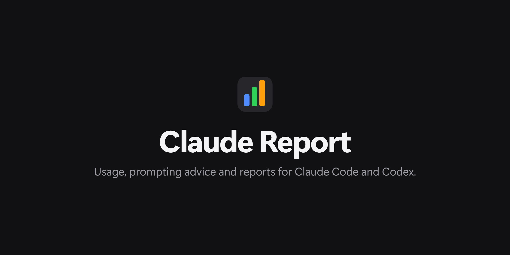
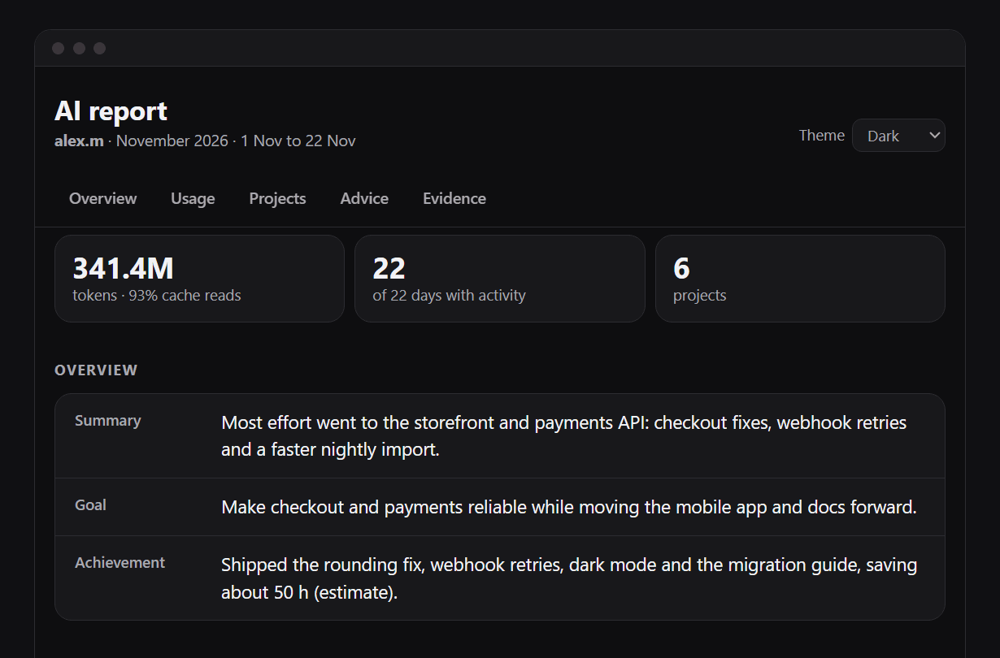
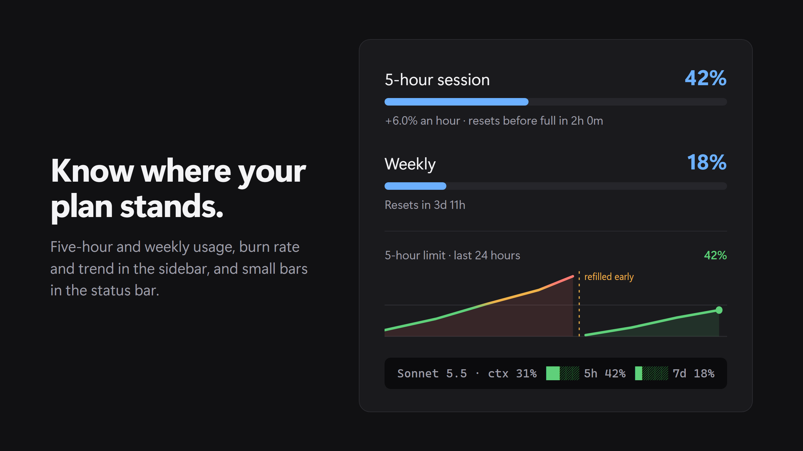
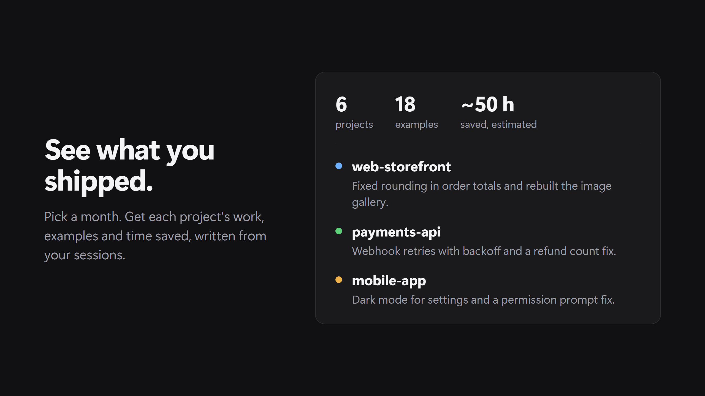
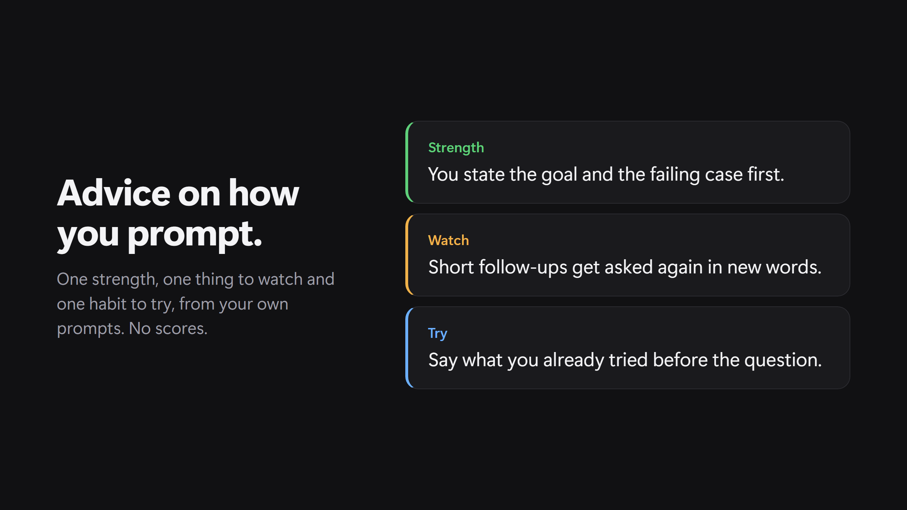
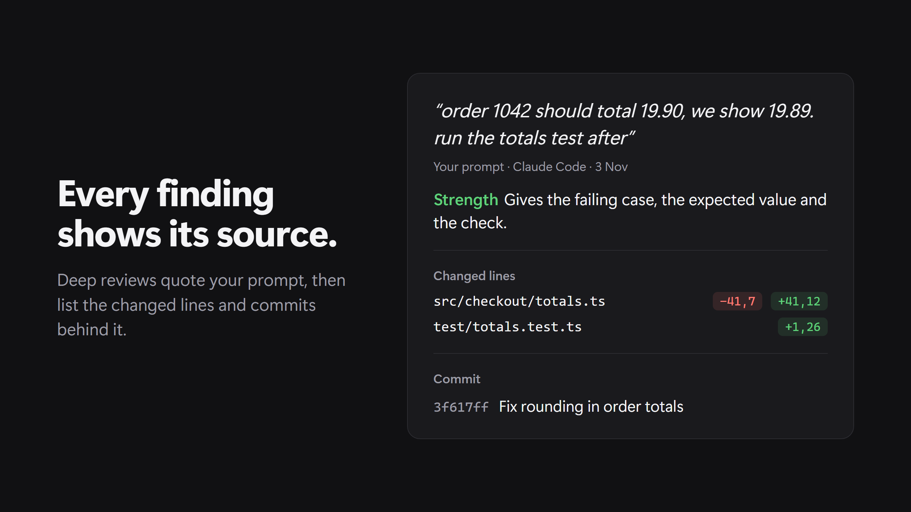



  
  
  

Claude Report shows your Claude Code, Codex, Antigravity and Cursor usage inside your editor, and turns a month of sessions into a report: what you shipped, how you prompt, and the commits behind it. It works in VS Code, Cursor, Windsurf, Antigravity and other Open VSX editors.

## Also included

- **Sessions:** browse your Claude Code history and resume any session in its own folder.
- **Status bar:** model, context, and five-hour and weekly usage as small bars.
- **Tidy sidebar:** sections fold from their headings, and long lists show the first rows with the rest behind a scrollable "more".
- **Cloud or local:** choose a signed-in CLI and its models to write your report, or use LM Studio or Ollama on your machine. Cloud previews estimate the share of your subscription when local quota history supports it and show the expected workload otherwise.
- **Export:** save reports as HTML or PDF.
- **Private:** reads local transcripts, redacts common secrets, no telemetry.

## Supported agents

| Agent | What is read | Tokens |
| --- | --- | --- |
| Claude Code | Local transcripts | Yes |
| Codex | Local session rollouts | Yes |
| Antigravity | Conversation index (read-only) | No |
| Cursor | Chat state database (read-only) | Only when Cursor records them |

Antigravity and Cursor need SQLite support: the editor's built-in `node:sqlite`, or `node` 22.13+ or 24 on your PATH. Devin (cloud sessions, no local transcripts) and Windsurf (encrypted history) are not supported.

## Get started

1. Install **Claude Report** from the Extensions view.
2. Open **Claude Report** in the activity bar to see Sessions and Metrics.
3. Plan gauges use your Claude Code login automatically. Optional: open **Connect** to add the status-line hook as another source (needs Node.js).
4. In **Report**, choose a date range, select projects, and expand your cloud hook to choose models. Review the usage estimate before pressing **Create report**.

[Full guide](docs/guide.md) · [Privacy](docs/privacy.md) · [Troubleshooting](docs/troubleshooting.md) · [Changelog](CHANGELOG.md)

Independent project, not affiliated with Anthropic or OpenAI. Claude and Claude Code are trademarks of Anthropic, PBC. Images use invented data. Metrics layout adapted from [Claude Control](https://github.com/lucasdonordeste/claude-control) by Lucas do Nordeste.
