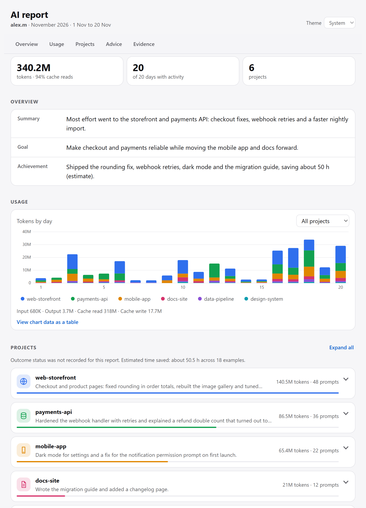
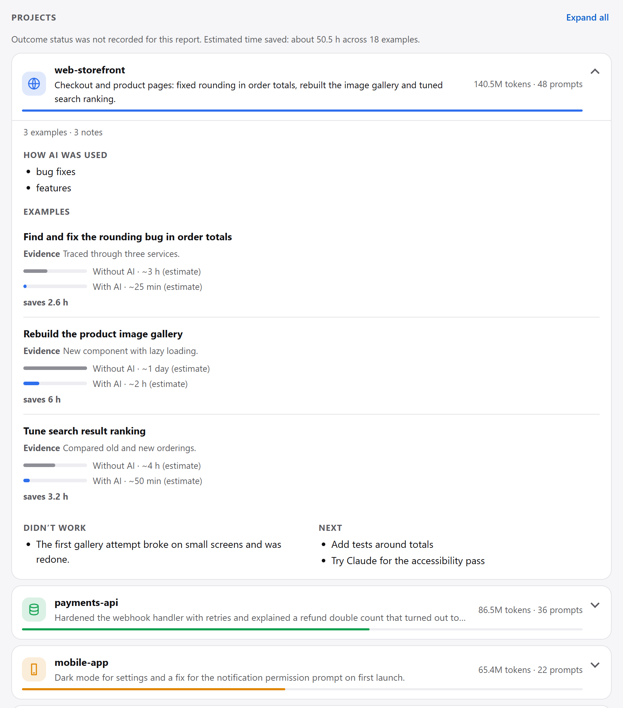
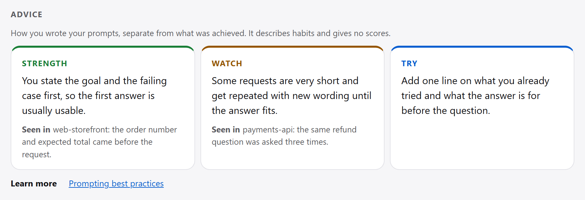

# Claude Report guide

The full reference for [Claude Report](../README.md): setup, requirements, what each view shows, how reports are made, where files are saved, privacy and development.

## Install and start

1. Search for **Claude Report** in the Extensions view (in Cursor, try `claude-report` with a hyphen), or install it from the [Visual Studio Marketplace](https://marketplace.visualstudio.com/items?itemName=haitham72.claude-report). Cursor, Windsurf, Antigravity, VSCodium and other editors that use [Open VSX](https://open-vsx.org/extension/haitham72/claude-report) find it in their Extensions view too. To install a file from the [latest release](https://github.com/haitham72/claude-report/releases/latest) instead, choose **Extensions → Install from VSIX…**, or run `code --install-extension claude-report-<version>.vsix`. Local builds are in `dist/`.
2. Open **Claude Report** in the activity bar. **Sessions** shows Claude Code history. **Metrics** reads the last 30 days of activity from local transcripts. Plan usage (5-hour and weekly) fills from your Claude Code login automatically; turn off `claudeReport.planUsage.enabled` to stop those API calls.
3. Optionally open **Connect** and install the Claude Code status line hook as another plan-usage source. This requires Node.js on your PATH. The hook keeps your previous status line and supports **Disconnect**.
4. In **Report**, choose a month or custom date range, select your projects, choose **Quick** or **Deep**, and press **Create report**. Cloud generation requires the signed-in `claude` command. Local generation requires a model in LM Studio or Ollama.

## Requirements

| For | You need |
| --- | --- |
| Sessions, Metrics, model and context in the status bar | VS Code 1.75 or later, or a compatible editor, and Claude Code, Codex, Antigravity or Cursor activity on this computer |
| Antigravity and Cursor tabs | SQLite support: Node's built-in `node:sqlite` in the editor's runtime, or else the system `node` (22.13 or later, or 24) on PATH. Without it, those tabs do not appear |
| Plan usage gauges and trend | A Claude.ai login in Claude Code (Pro, Max, Team or Ultra), or the optional **Connect** status-line hook with Node.js on PATH |
| Cloud reports | The `claude` command, signed in |
| Local reports | LM Studio or Ollama installed. The extension starts the server and loads a model if needed |
| PDF export | Microsoft Edge, Google Chrome or Chromium |

The test suite has so far only been run on Windows. The macOS and Linux code paths exist but are unverified. The optional Outlook email draft works on Windows and macOS only.

## Activity and usage

| Surface | Data and behavior |
| --- | --- |
| **Sessions** | Lists Claude Code sessions, indicates active processes, and resumes a session in its original working directory. |
| **Status bar** | Shows model and context from live Claude Code readings or transcript estimates. The five-hour and weekly plan gauges require the status line hook. |
| **Metrics → Tokens** | Each source with data gets its own tab (Claude, Codex, Antigravity, Cursor, All), and projects are merged across sources. Filter by the open project. Includes input, output and cache usage, along with supported tool, model and activity breakdowns. Until you pick a tab, Metrics opens on the editor's own agent (Antigravity in Antigravity, Cursor in Cursor), otherwise on Claude, including in Devin and Windsurf. Your last pick is remembered. |
| **Metrics → Plan usage** | Shows the latest five-hour and weekly percentages and reset countdowns from the Claude Code status line, on the Claude and All tabs only. Burn-rate estimates use at least 15 minutes of readings from the current quota window. |
| **Metrics → Trend** | Plots five-hour plan readings for the last 24 hours and weekly readings for the last seven days. Reuses saved Claude Control readings when available. Dashed markers indicate recorded reset times, and gaps show where readings are missing. |

The activity scan reads `~/.claude/projects/**/*.jsonl`, Codex rollouts under `~/.codex/sessions` or `$CODEX_HOME/sessions`, Antigravity's `~/.gemini/antigravity/conversation_summaries.db` and Cursor's `globalStorage` `state.vscdb`. The last two are opened read-only and need the SQLite support listed under Requirements. `ANTIGRAVITY_HOME` and `CURSOR_STATE_DB` override their default locations. It groups transcript working directories by their nearest Git root, or by the working directory itself if it has no repository. The report picker lists projects with eligible user prompts in the selected dates, regardless of which folder is open. File edits and commits alone do not create report eligibility. Git commits are supplementary evidence attached to selected projects.

What each source provides:

| Source | Sessions | Prompts | Turns | Tokens |
| --- | --- | --- | --- | --- |
| Claude Code, Codex | Yes | Yes | Yes | Yes |
| Antigravity | Yes | Latest prompt per conversation | Agent steps | No |
| Cursor | Chats and agent runs | Yes | Assistant replies | Summed when Cursor records them; recent versions record none |

Antigravity stores token counts in an undocumented format, which is not decoded, and its index has no per-prompt times, so only the latest prompt of each conversation is counted. Projects come from the workspace folder (Antigravity) or the chat's workspace (Cursor). Antigravity subagent conversations and Cursor sub-agent and best-of-N runs add turns but not sessions or prompts. Reports can cite prompts from all four sources.

Devin is not supported because its agent sessions run in the cloud and leave no local transcripts. Windsurf is not supported because its Cascade history is encrypted on disk.

The scan covers the named sources. Native chats in other assistants, browser chat sessions, direct API usage, and standalone model-server chats are outside that coverage. Plan usage history comes from the status line and the local Claude Control usage file when present. Cache efficiency is calculated from transcript token counts.

## Report workflow

- **Quick** scans and redacts activity, then sends a bounded evidence sample per project. The model writes a short summary and an expanded card. The expanded card can include eight examples with separate details and evidence, plus how AI helped, friction, and next steps. A short draft can receive one expansion pass when enough evidence exists. The period overview is generated separately from the project drafts.
- **Deep** adds an independent review for each project at the selected depth. Low includes the user's prompts. Medium also includes relevant filenames and root project documentation. High also includes selected changed lines. Cloud mode runs up to three project reviews at a time on Haiku, then Sonnet synthesizes their findings in the final report. A run reviews at one depth only and stays inside a request budget shown before it starts. The preflight plans around the reviewer context, batches oversized evidence by session, and reuses cached reviews with matching evidence.
- **Advice** is a separate section of the report, apart from the achievements. It shows one strength, one thing to watch and one habit to try, each with where it was seen, based on how your prompts were phrased. It gives no scores, and under ten prompts it is labelled a first look. Its Learn more links come from a fixed list of official documentation pages, never from the model.
- **Progress** shows List and Flow views, elapsed time, completion, and any failures. Open the finished report when ready. The HTML has a section nav, a ranked project list, a token chart that scales to the period or selected project, and System, Light and Dark themes. Examples are labelled Requested, Recorded or Verified.
- **Manage** lets you open a report, edit or remove projects, export, enhance all or selected projects with another model, compare revisions, review runtime timings, and manage saved copies. Enhance normally reuses the saved evidence sample. Create a fresh report for the same dates to use the current scanner and available history.
- **AI time estimates** are optional. Edit an example to record time yourself. A user-supplied value takes precedence where a task matches.

In **Cloud**, Quick defaults to Haiku at medium effort for project cards and Sonnet at high effort for the overview. Deep uses Haiku for project reviews and Sonnet for its final synthesis. In **Local**, the selected model handles both parts on this computer. The Report tab has a Model section with a Cloud or Local switch. With Local on it shows the chosen model, or "Auto: best model that fits", and a "Choose model..." link that opens the full picker in the Connect tab.

The extension never starts a local server on its own. If LM Studio or Ollama is not running, a local report asks you to open it (Open, Recheck or Cancel) and the Connect tab shows an Open button. Open runs `lms server start` for LM Studio (opening the app if its service does not wake) or `ollama serve` for Ollama, and only after you click it. With no model picked, it uses the loaded model, else the largest model that fits in free GPU memory with at least 16k context, else the smallest.

If the model file is larger than the free GPU memory, it shows one short note ("<model> is larger than your free GPU memory, so it may run slower.") with Continue or Use <a smaller model that fits>. Models that fit load without asking, and with no NVIDIA card there is nothing to measure. A load that really runs out of memory says so and names models that fit. See [Reports](reports.md) and [Local models](local-models.md).

<p align="center">
  
</p>

<p align="center">
  
</p>

<p align="center">
  
</p>

All screenshots use invented projects and numbers.

## Saved reports and exported files

Saved runs live in `~/.claude-report/reports/<YYYY-MM>/runs/<timestamp>/`. Each run includes the HTML and JSON plus optional private evidence and metadata used for enhancement and runtime logs. A revision creates a separate run.

An exported copy goes to `Downloads/Reports/<Month_Year>/Report_MM-DD-YYYY_HH-mm-ss_name.html` by default. A custom export folder becomes the parent of the month folders. Use **Manage → Manage exported copies → Show in folder** to locate a tracked copy. PDF export uses Edge or Chrome.

## Privacy

The extension scans local files and has no telemetry. Cloud generation sends selected, redacted evidence through the configured Claude Code sign-in. Local generation sends it to the local model server. The extension filters environment-file prompts and redacts common secret patterns. Review exports before sharing. The optional status line hook updates Claude Code settings after Connect and restores the previous setting on Disconnect. See the [privacy reference](privacy.md).

## Development

The extension uses Node.js, worker threads and VS Code webviews. It has no runtime package dependencies or bundler. The extension host is `extension.js`. The sidebar and the self-contained report are in `template/`. Data collection, generation, rendering and storage are in `src/`. The model instructions are in `skills/`.

For report design work, start with `template/report.html` and use `design/build-preview.js` with `DEMO=1` to preview synthetic data. The layout should keep the period overview, activity charts, project examples, and prompting review easy to scan separately. The same HTML renders in the editor, the browser, and PDF export.

| Change | Start here |
| --- | --- |
| Sessions, metrics, project identity | `src/sessions.js`, `src/scan-worker.js`, `src/scan.js`, `src/codex-activity.js`, `src/antigravity-activity.js`, `src/cursor-activity.js`, `src/sqlite-read.js`, `src/sources.js` |
| Status line and plan history | `bin/hook.js`, `src/live.js`, `template/panel/metrics.js` |
| Report generation and models | `src/generate.js`, `src/overview.js`, `src/claude.js`, `src/local-report.js`, `src/local-fit.js`, `skills/` |
| Deep evidence, scheduling and cache | `src/deep-git.js`, `src/deep-review.js`, `src/deep-stages.js` |
| Saved reports, editing and exports | `src/report-store.js`, `src/report-management.js`, `src/report-editor.js`, `src/export.js` |
| Report UI and progress | `template/report.html`, `src/render.js`, `template/panel/shell.html` |

```powershell
node --test
npm.cmd run package
```

Use `npm run package` on shells that allow the npm script. The build writes `dist/claude-report-<version>.vsix`.

[Architecture](how-it-works.md) · [Troubleshooting](troubleshooting.md) · [Contributing](../CONTRIBUTING.md) · [Releasing](releasing.md) · [Changelog](../CHANGELOG.md)

The Metrics layout is adapted from [Claude Control](https://github.com/lucasdonordeste/claude-control) by Lucas do Nordeste. Claude Report is released under the [MIT license](../LICENSE).
