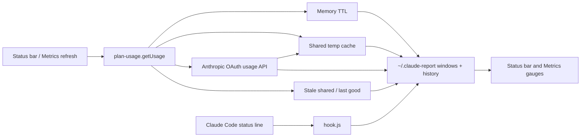
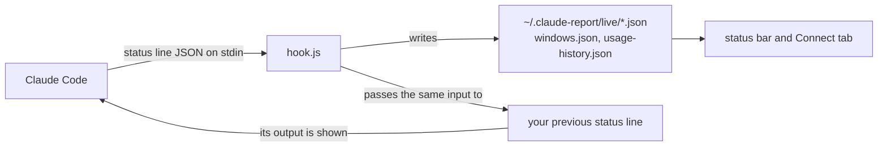
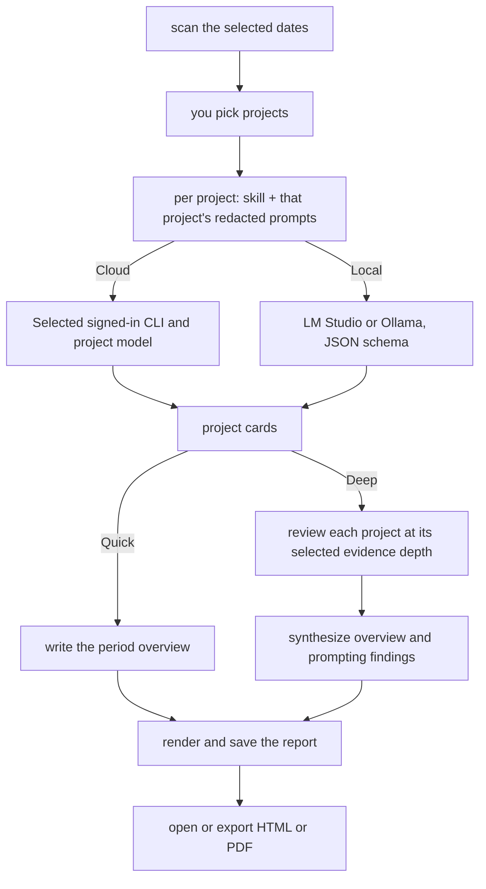

# How it works

Claude Report is plain Node with no runtime dependencies and no bundler. This page explains where its numbers come from and how the pieces fit, for people who want to trust it, debug it or change it.

## Data sources

| What you see | Where it comes from |
| --- | --- |
| Sessions list | `~/.claude/projects/*/*.jsonl` (the title is the latest `ai-title` record, else the first prompt) and `~/.claude/sessions/*.json` (a session is running when its process is alive) |
| Metrics, daily chart | Claude Code JSONL transcripts and Codex rollouts. Supported token counts, user prompts, models and tool data come from timestamped records |
| Model and context in the status bar | The newest transcript for the open folder: the last assistant turn's model and its prompt size over a 200k window (1M once a turn exceeds it). This is a heuristic |
| 5h and 7d usage | Several routes, newest wins: OAuth plan-usage poll (`src/plan-usage.js`, same as `/usage`), shared temp cache, and the status-line hook (`bin/hook.js`). `src/live.js` keeps timestamped samples and resets for the Metrics charts |
| Report text | The selected CLI subscription or local model |

Scanning and rendering use local files. Cloud generation delegates to the selected, signed-in CLI. Local generation sends requests to the selected localhost model server.

## Plan usage routes

- **Default on.** Setting `claudeReport.planUsage.enabled` controls the OAuth poll. No prompt: it reuses the Claude Code login already on the machine, like Claude Control.
- Routes are tried in order: fresh memory → fresh shared cache → OAuth API (if a token exists) → stale shared/last good. The status-line hook remains a parallel writer into the same store.
- API-key-only Claude Code logins have no OAuth token; gauges then need the hook or another tool writing the shared cache.

## The status line hook

- **Connect** copies `bin/hook.js` and `src/live.js` to `~/.claude-report/runtime/` and points `statusLine` in `~/.claude/settings.json` at that copy, using the absolute path of your Node. The copy is outside the extension folder so an extension update cannot orphan it. A backup `settings.json.claude-report.bak` is written once.
- If you already had a status line, its command is saved in `~/.claude-report/config.json` and the hook runs it with the same input and prints its output, so your display does not change. If that program has been uninstalled, the hook prints its own coloured line instead and Connect offers to remove the dead entry.
- The hook never fails: bad input or a missing folder produces an empty line, never an error.
- The 5h and 7d windows belong to the account. Claude Code sometimes sends a reading without them (for example right after a restart), so the last good values are kept in `windows.json` until the window resets.
- **Test** runs the exact saved command with a sample reading and tells you whether it ran, what it printed and whether it saved a reading.

## The report pipeline

- The scan runs in a worker thread so the editor stays responsive.
- Cloud project cards and reviews use up to three workers. The overview model receives the cards and, for Deep, the validated project findings. Local project requests run one at a time. Each project shows `queued`, `gathering`, `working` and `done` or `failed` in the sidebar.
- Cloud CLIs run in a dedicated temporary workspace with temporary or ephemeral session flags where provided. The activity scan skips report workspace sessions.
- The cloud discovery worker checks eligible CLI sign-ins, models and available quota readings. Subscription estimates use the report workload and, where supported, recent local measurements for the user's quota windows.
- Project names come from the Git root of the session's folder. A session started in your home folder is called `home`. If the folder has no Git root, its own name is used. A Git commit is supplementary evidence for an eligible project.

## Layout of the code

| Path | Role |
| --- | --- |
| `extension.js` | Activation, status bar, sidebar host, commands, report flow |
| `template/panel/` | The sidebar page: `shell.html` (tabs, Sessions, Report, Connect) and the Metrics tab port |
| `template/report.html` | The report page, filled from one JSON block |
| `skills/` | The instructions given to Claude for the report |
| `src/scan.js`, `src/codex-activity.js`, `src/scan-worker.js` | Transcript scan, project attribution, redaction and environment-file filtering |
| `src/sessions.js`, `resume.js` | Session list and where to resume one |
| `src/generate.js`, `src/overview.js`, `src/claude.js`, `src/local-report.js` | Writing the report |
| `src/cloud-providers.js`, `src/cloud-scan-worker.js`, `src/quota-estimate.js`, `src/quota-calibration.js` | Cloud sign-in discovery, model runners and subscription impact estimates |
| `src/deep-review.js`, `src/deep-stages.js`, `src/deep-git.js` | Prompt evidence, context budgeting, source fingerprints, and independent project reviews |
| `src/report-store.js`, `src/report-management.js` | Saved runs, revisions, evidence and export history |
| `src/local-models.js` | Detecting LM Studio and Ollama, GPU memory, context limits |
| `src/transcript-live.js`, `live.js`, `live-merge.js`, `plan-usage.js`, `statusbar.js` | Live numbers, plan-usage poll and the status bar items |
| `src/install.js`, `atomic.js`, `bin/hook.js` | Installing the hook, safe file writes, the hook itself |
| `src/export.js`, `mail.js` | PDF, saving, Outlook draft |
| `design/` | Preview builders and sample data for screenshots |

## Resuming a session

Claude Code stores a session under the folder it ran in and can only find it again from that folder. A session from the folder you have open resumes in the Claude Code panel (`claude-vscode.primaryEditor.open`). Any other session opens a terminal in its own folder and runs `claude --resume <id>`, which works whichever editor created it. If the Claude Code extension is not installed, New session and Resume use a terminal too; if it is installed, they never fall back to the command line.
